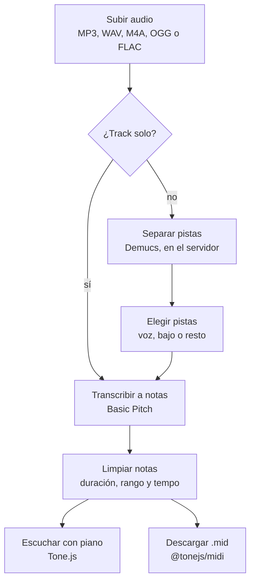

# 02 · Arquitectura

El track solo se procesa completo en el navegador. La canción completa agrega dos pasos en un servidor antes de transcribir.

## Flujo del sistema



El paso de transcripción es el mismo en los dos modos. Lo único que cambia es qué audio recibe. Separar y elegir pistas solo existen desde la fase 2.

## Piezas abiertas

| Pieza | Función | Dónde corre | Licencia |
| --- | --- | --- | --- |
| [basic-pitch-ts](https://github.com/spotify/basic-pitch-ts) | Transcribe audio a notas | Navegador | Apache-2.0 |
| [Basic Pitch](https://github.com/spotify/basic-pitch) | El mismo modelo en Python, para la fase 0 y como plan B | Servidor | Apache-2.0 |
| [Demucs](https://github.com/adefossez/demucs) | Separa voz, bajo, batería y resto | Servidor | MIT, por confirmar |
| [Tone.js](https://github.com/Tonejs/Tone.js) | Reproduce las notas con sonido de piano | Navegador | MIT, por confirmar |
| [@tonejs/midi](https://github.com/Tonejs/Midi) | Escribe el archivo .mid | Navegador | MIT, por confirmar |
| [Transkun](https://github.com/Yujia-Yan/Transkun) | Motor alternativo, más preciso para piano | Servidor | MIT |

Las licencias de Basic Pitch, basic-pitch-ts y Transkun vienen de la API de GitHub al 15 de noviembre de 2026. Las marcadas por confirmar son de memoria y se revisan antes de usarlas.

Referencias para mirar, sin integrarlas: [NeuralNote](https://github.com/DamRsn/NeuralNote) (plugin que usa Basic Pitch, útil para la limpieza de notas) y [oh-my-score](https://github.com/SleepyLGod/oh-my-score) (estudio de piano en navegador que ya hace audio a MIDI).

## Stack propuesto

El stack es una propuesta. Se confirma al empezar cada fase.

| Fase | Capa | Propuesta |
| --- | --- | --- |
| 1 | Proyecto web | Vite con TypeScript, sitio estático |
| 1 | Lectura de audio | Web Audio API, convertido a mono y 22.050 Hz |
| 1 | Transcripción | basic-pitch-ts dentro de un Web Worker |
| 1 | MIDI y sonido | @tonejs/midi y Tone.js |
| 1 | Hosting | GitHub Pages o Vercel |
| 2 | Servicio | Python con FastAPI y una cola de trabajos |
| 2 | Separación | Demucs, con ffmpeg para convertir formatos |

## Estructura sugerida del repositorio

```
audio-a-midi/
  docs/        plan (esta carpeta)
  backlog/     historias y tareas
  fase-0/      prueba de concepto en Python
  web/         aplicación del navegador (fase 1)
  servidor/    servicio de separación (fase 2)
```

## Decisiones de diseño

- En canción completa, el servidor solo separa pistas. La transcripción sigue en el navegador, igual que en track solo.
- Cada pista elegida queda como una pista MIDI separada dentro del mismo archivo.
- La batería no se transcribe.
- Ajustar la sensibilidad no vuelve a correr el modelo: solo recalcula las notas desde la salida ya obtenida.
