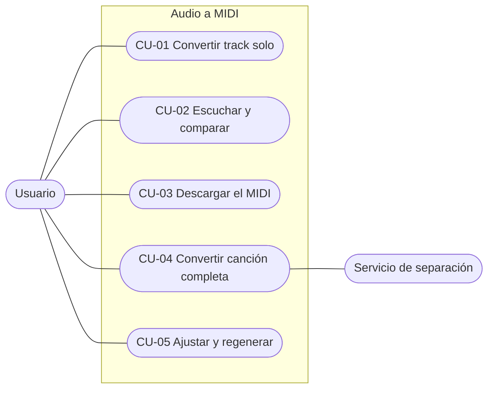

# 04 · Casos de uso

Son 5 casos de uso. El usuario participa en todos. El servicio de separación solo interviene en CU-04.

CU-02, CU-03 y CU-05 parten siempre de un resultado que dejó CU-01 o CU-04.

## CU-01 · Convertir un track solo a MIDI

Es el caso principal y el único que debe funcionar al terminar la fase 1.

- Actor: usuario.
- Fase: 1.
- Historias: H1, H2, H3 y H6.
- Precondición: el usuario tiene un audio de un instrumento o una voz, de hasta 10 minutos.
- Postcondición: hay un MIDI listo en el navegador y el audio no salió del equipo.

Flujo principal:

1. El usuario abre la página y sube el audio.
2. El sistema valida el formato y la duración, y muestra el nombre y la duración.
3. El usuario deja marcado track solo y pulsa Convertir.
4. El sistema transcribe el audio en el navegador y muestra el avance.
5. El sistema muestra el resultado, listo para escuchar y descargar.

Flujos alternos:

- 2a. El archivo no se puede leer: el sistema muestra los formatos aceptados y vuelve al paso 1.
- 2b. El audio supera 10 minutos: el sistema muestra el límite y vuelve al paso 1.
- 4a. El usuario cancela: el proceso se detiene y el audio queda cargado.
- 4b. No se detectan notas: el sistema avisa y sugiere probar con otro audio.
- 4c. El navegador se queda sin memoria: el sistema avisa y sugiere un audio más corto.

## CU-02 · Escuchar y comparar el resultado

El usuario decide aquí si el MIDI le sirve, antes de descargarlo.

- Actor: usuario.
- Fase: 1. El piano roll se suma en la fase 3.
- Historias: H4 y H11.
- Precondición: CU-01 o CU-04 terminó con un resultado.
- Postcondición: el MIDI no cambia.

Flujo principal:

1. El usuario pulsa reproducir.
2. El sistema toca el MIDI con sonido de piano.
3. El usuario cambia al audio original.
4. El sistema cambia la fuente y mantiene la posición.
5. El usuario mueve la posición o pausa.

Flujos alternos:

- 2a. El navegador bloquea el sonido hasta que haya un toque: el sistema pide tocar la pantalla.

## CU-03 · Descargar el MIDI

Es el entregable del producto: un archivo .mid en el equipo del usuario.

- Actor: usuario.
- Fase: 1.
- Historias: H5.
- Precondición: CU-01 o CU-04 terminó con un resultado.
- Postcondición: el archivo .mid queda guardado en el equipo.

Flujo principal:

1. El usuario pulsa Descargar.
2. El sistema genera el archivo .mid con el nombre del audio.
3. El navegador guarda el archivo.

Flujos alternos:

- 3a. El navegador bloquea la descarga: el sistema muestra un enlace para guardarlo a mano.

## CU-04 · Convertir una canción completa a MIDI

Es el único caso con un segundo actor, el servicio de separación, y el único en que el audio sale del equipo.

- Actores: usuario y servicio de separación.
- Fase: 2.
- Historias: H6, H7 y H8.
- Precondición: el usuario tiene una canción de hasta 10 minutos y conexión a internet.
- Postcondición: hay un MIDI con una pista por cada pista elegida, y el audio se borra del servidor a más tardar 1 hora después.

Flujo principal:

1. El usuario sube la canción y marca canción completa.
2. El sistema avisa que el audio va a un servidor y que se borra en 1 hora, y el usuario acepta.
3. El sistema envía el audio y muestra el estado de la cola con un tiempo estimado.
4. El servicio de separación devuelve voz, bajo y resto.
5. El usuario escucha las pistas y marca las que quiere.
6. El sistema transcribe las pistas marcadas, igual que en el paso 4 de CU-01.
7. El sistema muestra el resultado, listo para escuchar y descargar.

Flujos alternos:

- 2a. El usuario no acepta: el sistema no envía nada y ofrece el modo track solo.
- 3a. El servicio no responde o la cola está llena: el sistema avisa y permite reintentar.
- 4a. La separación falla: el sistema permite reintentar o subir un track solo.
- 5a. El usuario no marca ninguna pista: el botón Convertir queda desactivado.
- 6a. Una pista marcada no tiene notas: el sistema la omite y lo avisa.

## CU-05 · Ajustar y regenerar

Permite mejorar un resultado sin empezar de nuevo.

- Actor: usuario.
- Fase: 3.
- Historias: H9 y H10.
- Precondición: CU-01 o CU-04 terminó con un resultado.
- Postcondición: el MIDI nuevo reemplaza al anterior en la reproducción, el piano roll y la descarga.

Flujo principal:

1. El usuario cambia la sensibilidad o activa y apaga limpiezas.
2. El usuario pulsa Regenerar.
3. El sistema recalcula las notas sin pedir el audio otra vez.
4. El sistema actualiza la reproducción, el piano roll y la descarga.

Flujos alternos:

- 1a. El usuario pulsa Restablecer: vuelven los valores iniciales.
- 3a. El resultado nuevo no tiene notas: el sistema avisa y conserva el anterior.
