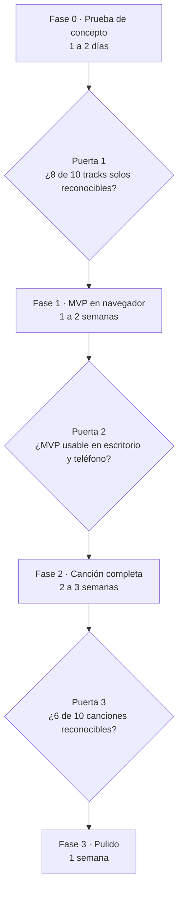

# 05 · Roadmap

El plan suma entre 4 y 6 semanas después de la prueba de concepto, repartidas en 4 fases con una puerta de decisión entre cada una. Las duraciones son estimaciones para una persona.

| Fase | Duración | Entregable | Historias | Tareas |
| --- | --- | --- | --- | --- |
| 0 · Prueba de concepto | 1 a 2 días | Basic Pitch corrido sobre los 10 tracks solos, con puntaje | Ninguna | `backlog/tareas-fase-0.md` |
| 1 · MVP en navegador | 1 a 2 semanas | Track solo: subir, transcribir, escuchar y descargar | H1 a H6 | `backlog/tareas-fase-1.md` |
| 2 · Canción completa | 2 a 3 semanas | Servidor que separa pistas y deja elegir cuáles usar | H7 y H8 | `backlog/tareas-fase-2.md` |
| 3 · Pulido | 1 semana | Sensibilidad, limpieza de notas y piano roll | H9 a H11 | `backlog/tareas-fase-3.md` |

## Puertas

Las puertas son criterios de aceptación. Para `v0.1.0` se adelantó la implementación de las fases 1 a 3 y su validación se realizará en conjunto. Consulta el [estado del backlog](../backlog/) y registra la evidencia contra el [commit de la versión](registro-avances.md).

| Puerta | Pregunta | Si no se cumple |
| --- | --- | --- |
| 1 | ¿8 de 10 tracks solos reconocibles? | Probar Transkun para piano o ajustar los umbrales antes de construir el MVP |
| 2 | ¿MVP usable en escritorio y teléfono? | Corregir antes de abrir la fase 2 |
| 3 | ¿6 de 10 canciones reconocibles? | El producto queda como track solo y la fase 3 se hace igual |
